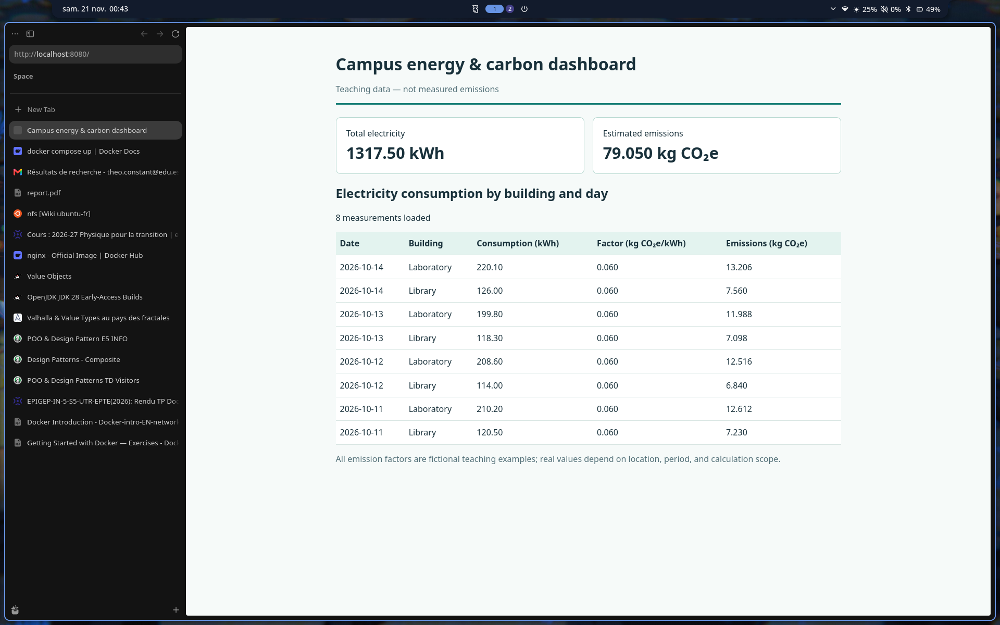

# Cloud Computing - Getting started with docker

Théo Constant E5INFO

## Introducing Containers

The Debian container stopped imediatly after being executed.

`sudo docker ps -l`

```sh
CONTAINER ID   IMAGE                COMMAND   CREATED         STATUS                     PORTS     NAMES
7e80cb20630e   debian:trixie-slim   "bash"    3 minutes ago   Exited (0) 3 minutes ago             upbeat_hofstadter
```

CONTAINER ID is the id of the container

IMAGE is the name of the image used for this container

COMMAND is the last command used on this container

CREATED is time passed after the container has been created

STATUS is how the container is. It can be created, started, or exited with
a code.

PORTS is the ports it is exposing

NAMES is the name of the container, you can either use the name or the id to
reference the container.

An image is like a class, while a container is like an instance or object of this class.

`docker run` try to create the container by searching the image localy first and if it does not find the it localy, docker downloads it first, then it start it. `docker start` only tries to start a container already created.

`-i` or `--interactive=true|false` keep STDIN open even if not attached. By default it is false. (from the man page)

`-t` or `--tty=true|false` allocate a pseudo-TTY. By default it is false. When set to true, Docker allocate a pseudo-tty and attach to the standard input of any container. This can be used to run a throwaway interactive shell for exemple. (from the man page)

together, `-it` or `--interactive --tty` can be used to have an interactive terminal inside the container.

If you omit `-it` with the debian image, it is not possible to interact with debian through a tty and it stop running after being started. It should not apply to every image, because some image might have some services that would keep the container alive.

To stop a container, you can use the `docker stop container <name>` command. To remove a stopped container you can use the `docker container rm <name>` command.

## Running a web server

### Nginx

`-d` or `--detach=true|false` allows to run the container in detached mode, in the background

`-it` is not necessary because it is a server, it is waiting for connections, so no need to use `-it` to keep it alive.

### Hello Docker Hub

```sh
#!/bin/sh
echo hello mon tuteur :D
```

```Dockerfile
FROM ubuntu:24.04
LABEL version="0.1" maintainer="thosu"
RUN apt-get update && apt-get upgrade -y
WORKDIR /hello-dir
COPY hello.sh .
RUN chmod +x hello.sh
ENTRYPOINT ["./hello.sh"]
```

Build command : `docker build -t thosufinal/hello:0.1 .` (I had some issue with
buildx, it works with build even if it is deprecated) 

Run command : `docker run --rm thosufinal/hello:0.1`

Create a new tag command : `docker tag thosufinal/hello:0.1
thosufinal/hello:latest`

Publish it to Docker Hub : `docker push thosufinal/hello:latest` or `docker
image push thosufinal/hello:latest`

You can now pull the image from Docker Hub with this command : `docker run
thosufinal/hello:latest`

All my repositories are here : https://hub.docker.com/repositories/thosufinal

## Practical task

### Program

Here is the python program. I would have loved to make it in C, Rust, Bash or
even in Assembly, but I don't have enough time :(

```py
from random import randint
from datetime import date

print("[Practical Tasks] Hello")
print("[Practical Tasks] Here are three random numbers between 1 and 1000 inclusive:");
for i in range(3):
    print(f"\t{randint(1, 1001)}")
print("[Practical Tasks] Here is the today's date:")
print(f"\t{date.today()}")
```

And here is the Dockerfile, I directly took a python image instead of taking
a linux image like debian and installing python by hand.

```Dockerfile
FROM python
# LABEL is useless, I do not want to publish it with my student credentials
WORKDIR /app
COPY program.py /app/program.py
RUN chmod +x /app/program.py
ENTRYPOINT ["python", "/app/program.py"]
```

You can pull the image with this command : `docker run
thosufinal/practicaltasks:latest`

### httpd

`$ docker run -dit --name my-apache-app -p 8080:80 -v "$PWD":/usr/local/apache2/htdocs/ httpd:2.4
`
The URL to access this website is `localhost:8080`

### MySQL

`sudo docker run --name some-mysql -e MYSQL_ROOT_PASSWORD=root -d mysql:8.4
`
`sudo docker exec -it some-mysql mysql`

```
CREATE DATABASE mydb;
USE mydb;
CREATE TABLE Client (
  id int PRIMARY KEY,
  firstname varchar(255),
  lastname varchar(255)
);
INSERT INTO Client VALUES (1, "Sylvain", "Cherrier");
SELECT * from Client;

+----+-----------+----------+
| id | firstname | lastname |
+----+-----------+----------+
|  1 | Sylvain   | Cherrier |
+----+-----------+----------+
1 row in set (0.00 sec)
```

`sudo docker container stop some-mysql`

`sudo docker start some-mysql`

```
USE mydb;
SELECT * from Client;

+----+-----------+----------+
| id | firstname | lastname |
+----+-----------+----------+
|  1 | Sylvain   | Cherrier |
+----+-----------+----------+
1 row in set (0.00 sec)
```

Après recherche de quel volume utilise le container avec la commande `docker inspect`, voici la commande :

`sudo docker run --name some-new-mysql -e MYSQL_ROOT_PASSWORD=root -d -p 3306:3306 -v 41958a7be9e10e2a457c61a266705903bc0fd1c2f82df8d6abc7a95d94a51c94:/var/lib/mysql mysql:8.4`

```
SELECT * FROM Client;
+----+-----------+----------+
| id | firstname | lastname |
+----+-----------+----------+
|  1 | Sylvain   | Cherrier |
+----+-----------+----------+
1 row in set (0.01 sec)
```

## Docker Compose

Compose is useful even for one container because the command you write to start
and stop the container is easy to remember and write, no need to provide
a name or publish the port by hand in the command, everything is written up in
the `compose.yaml` file. To start the container, you just write `docker compose
up -d` and to stop it you simply write `docker compose down`.

Here is the `compose.yaml` file for a Node-RED container.

```
services:
  nodered:
    image: nodered/node-red:latest-minimal
    ports:
      - "2000:1880"
    volumes:
      - save_nodered_data:/data
volumes:
  save_nodered_data:
```

We can start it with `docker compose up -d`. The `-d` stands for `detach` and
allows it to run it in the background. Without this, we would see the log. 

If we do some stuff, save it and then stop the container with `docker compose
down`, all the stuff is saved inside the volume "save\_nodered\_data". We can
test that by starting the container again and check if the stuff we did is
still saved. If we add `-v` after the command to stop the container, it will
delete all the saved data by deleting the volume.

Here is the `compose.yaml` file for a mysql and phpmyadmin containers.

```
services:
  db:
    image: mysql:latest
    restart: always
    environment:
      MYSQL_ROOT_PASSWORD: root
    volumes:
      - mysql_data:/data
    healthcheck:
        test: ["CMD", "mysqladmin" ,"ping", "-h", "localhost"]
        timeout: 20s
        retries: 10
  phpMyAdmin:
    image: phpmyadmin:latest
    ports:
      - 3000:80
    depends_on:
      db:
        condition: service_healthy
    restart: always
networks:
  myNet:
    driver: bridge
volumes:
  mysql_data:

```

This is important to add `depends_on` in phpmyadmin service, because it depends
on the "db" service, it needs this service to be started and healthy to
operate.
The phpMyAdmin service depends on the health of the db service. We check if
mysql is healthy with the command `mysqladmin ping`.

## Option B - Campus Energy and Carbon Dashbord

### Files

`frontend/Dockerfile`

```Dockerfile
FROM nginx:stable-alpine
COPY index.html style.css app.js /usr/share/nginx/html/
COPY default.conf /etc/nginx/conf.d/default.conf
EXPOSE 80
```

`frontend/default.conf`

```conf
server {
  listen 80;

  location / {
    root /usr/share/nginx/html;
  }

  location /api/ {
    proxy_pass http://api:5000;
	proxy_set_header Host $host;
	proxy_set_header X-Forwarded-For $proxy_add_x_forwarded_for;
  }
}
```

`backend/Dockerfile`

```Dockerfile
FROM python:3.13-slim
WORKDIR /app
COPY requirements.txt .
RUN pip install --no-cache-dir -r requirements.txt
COPY app.py .
CMD ["flask", "--app", "app", "run", "--host=0.0.0.0", "--port=5000"]
```

`--no-cache-dir` for the `pip install` avoid caching the packages installed for
future uses, so it keeps the container clean and small

Making the secrets for database credentiels : `echo root > secrets/mysql-root-password.txt` and `echo root > secrets/mysql-user-password.txt`

`compose.yaml`

```yaml
services:
  web:
    container_name: web-energy
    build: ./frontend
    ports:
      - "8080:80"
    networks:
      - web_net
    depends_on:
      - api

  api:
    container_name: api-energy
    build: ./backend
    networks:
        - web_net
        - data_net
    environment:
      DB_HOST: mysql
      DB_NAME: energy_lab
      DB_USER: energy_user
      DB_PASSWORD_FILE: /run/secrets/mysql_user_password
    secrets:
      - mysql_user_password
    depends_on:
      mysql:
        condition: service_healthy

  mysql:
    container_name: mysql-energy
    image: mysql:latest
    networks:
      - data_net
    volumes:
      - mysql_data:/var/lib/mysql
      - ./database:/docker-entrypoint-initdb.d:ro
    environment:
      MYSQL_DATABASE: energy_lab
      MYSQL_USER: energy_user
      MYSQL_ROOT_PASSWORD_FILE: /run/secrets/mysql_root_password
      MYSQL_PASSWORD_FILE: /run/secrets/mysql_user_password
    healthcheck:
      #test: mysqladmin ping
      test: mysql --user=root --password=$(cat /run/secrets/mysql_root_password) --execute="SHOW DATABASES;"
      interval: 5s
    secrets:
      - mysql_root_password
      - mysql_user_password

networks:
  web_net:
    driver: bridge
  data_net:
    driver: bridge
    internal: true

volumes:
  mysql_data:
    
secrets:
  mysql_root_password:
    file: ./secrets/mysql-root-password.txt
  mysql_user_password:
    file: ./secrets/mysql-user-password.txt
```

We create 3 services, web for the frontend, api for the backend, and mysql for
the database : 
- web and api are in the same network, api and mysql are in another same network.
- So web and mysql can't see each other.
- web waits for api to start, and api waits for mysql to be healthy to start.
- api declare some environment variables to be able to connect to the database.
- mysql declare some environment variables to create a database, create a user
- and for credentials.
- mysql use volumes to store the data in a named volume and to mount a file to
- init the database.
- mysql has a healtcheck to test when the database is ready.
- api and mysql use secrets to avoid hard coding and revealing the database
- credentials.
- networks, volumes and secrets are declare at the end of the file.

### Tests

Now we can test it.

`docker compose config` check if the `compose.yaml` file is correct. (it is)

`docker compose up -d --build` to build the containers before starting them

```sh
$ docker compose ps
NAME           IMAGE                  COMMAND                  SERVICE   CREATED              STATUS                        PORTS
api-energy     option-b-student-api   "flask --app app run…"   api       About a minute ago   Up About a minute             5000/tcp
mysql-energy   mysql:latest           "docker-entrypoint.s…"   mysql     About a minute ago   Up About a minute (healthy)   3306/tcp, 33060/tcp
web-energy     option-b-student-web   "/docker-entrypoint.…"   web       About a minute ago   Up About a minute             0.0.0.0:8080->80/tcp, [::]:8080->80/tcp
```

Here we can see that each container is started.

```sh
$ curl http://localhost:8080/api/measurements
{"measurements":[{"building":"Laboratory","emission_factor":0.06,"energy_kwh":220.1,"kg_co2e":13.206,"measurement_date":"2026-10-14"},{"building":"Library","emission_factor":0.06,"energy_kwh":126.0,"kg_co2e":7.56,"measurement_date":"2026-10-14"},{"building":"Laboratory","emission_factor":0.06,"energy_kwh":199.8,"kg_co2e":11.988,"measurement_date":"2026-10-13"},{"building":"Library","emission_factor":0.06,"energy_kwh":118.3,"kg_co2e":7.098,"measurement_date":"2026-10-13"},{"building":"Laboratory","emission_factor":0.06,"energy_kwh":208.6,"kg_co2e":12.516,"measurement_date":"2026-10-12"},{"building":"Library","emission_factor":0.06,"energy_kwh":114.0,"kg_co2e":6.84,"measurement_date":"2026-10-12"},{"building":"Laboratory","emission_factor":0.06,"energy_kwh":210.2,"kg_co2e":12.612,"measurement_date":"2026-10-11"},{"building":"Library","emission_factor":0.06,"energy_kwh":120.5,"kg_co2e":7.23,"measurement_date":"2026-10-11"}],"scope":"Demonstration measurements with fictional emission factors","total_kg_co2e":79.05,"total_kwh":1317.5}
```

`docker compose logs <container>` allows to see the logs of a container.

```sh
$ docker compose logs api
api-energy  |  * Serving Flask app 'app'
api-energy  |  * Debug mode: off
api-energy  | WARNING: This is a development server. Do not use it in a production deployment. Use a production WSGI server instead.
api-energy  |  * Running on all addresses (0.0.0.0)
api-energy  |  * Running on http://127.0.0.1:5000
api-energy  |  * Running on http://172.20.0.2:5000
api-energy  | Press CTRL+C to quit
api-energy  | 172.20.0.3 - - [20/Nov/2026 23:37:44] "GET /api/measurements HTTP/1.1" 200 -
```

As we can see, no container is directly called "api", but Docker automaticaly
use and config a DNS server with networks. So instead of using the ip of the
container inside the networks, we can reference it through it's name on the DNS
server. That is also why we can put `http://api:5000` inside the config of the
nginx reverse proxy instead of the actual ip address of the api service
container.



### Troubleshoot

I had a lot of issues during this exercise. I will describe and troubleshoot
them.

- The web service was starting but exit right after. It was because I forgot to
  add `depends_on` on the api service.
- The mysql service was not creating any database named "energy\_lab" because
  of a typo. Instead of writting "MYSQL\_DATABASE", I wrote "MYSQL\_DATABSE"
without the letter A. I make this typo everytime, even while writing this
sentence...
- Secrets were not working for the mysql service, so it was not possible to
  connect to the database with the root or the user. I just forgot to add the
secrets section under the mysql service
- I could connect with root but not with user in the database, because the
  documentation of Docker Secrets is not that good and I wrote
"MYSQL\_USER\_PASSWORD\_FILE" instead of "MYSQL\_PASSWORD\_FILE".
- The healthcheck on mysql service `mysqladmin ping` is not enough, it only
  pings when it is ready but not healthy. Thanks to a forum, I found that you
could check the health by connecting and testing a sql command, but I didn't
wanted to put the password hardcoded inside the file. To bypass that, I used
the command substitution in bash with the cat command `$(cat /run/secrets/mysql_root_password)`.

To do tests on my containers, specially the mysql service container, I gave
them a name so I could easily enter it with `docker exec -it mysql-energy
bash`. While inside the container, I could try to connect the the database with
`mysql -u root -p`, searching certain files like the secrets insde
`/run/secrets/` or checking the env variables like `echo $MYSQL_USER`

Also, to avoid repeating the `sudo` command in this exercise, I learned I could
add the docker group to my user with `sudo groupadd docker` and `sudo usermod
-aG docker $USER`, which is really nice.

A good trick is a way to delete every container is only one command : `docker rm -f $(docker ps -aq)`. The command `docker ps -aq` gives us the
container id of every container (started and stopped ones)

Another useful command is `docker system prune` that allows to remove unused
data like unamed image.

Finally, to test it on another device, I copied the files from another device
in my same local network with the `scp` command and test it. Everything was ok
!
